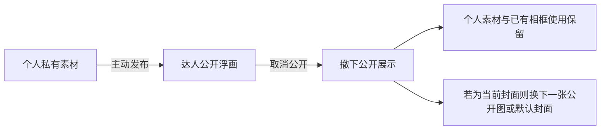
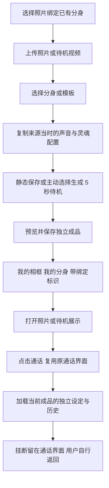
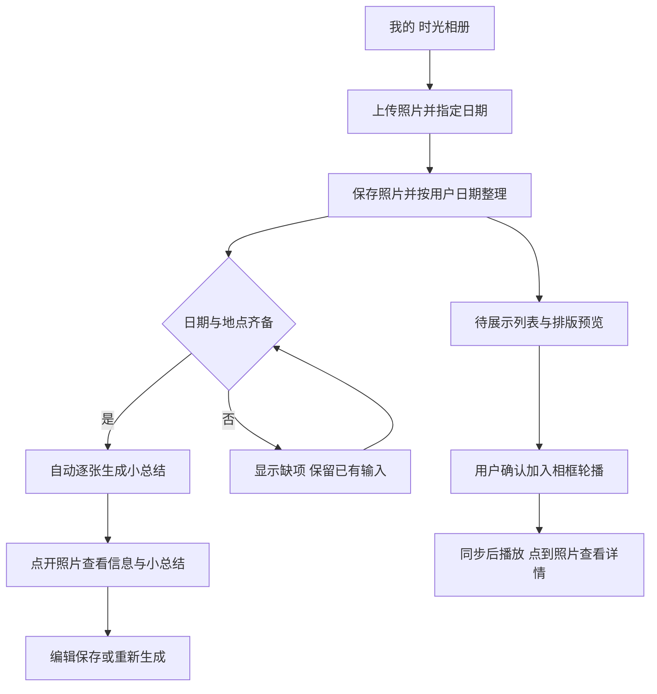
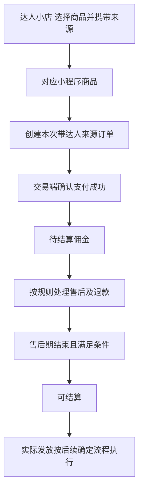

# 微圈 APP 本轮优化产品需求文档

用户任务与入口重组 分身创建简化 时光相册与达人小店

版本：PRD v1.0　日期：2026年10月16日　状态：需求评审版

面向产品、设计、客户端、服务端、相框端、测试、内容及运营团队。本文件将截至本日的讨论与确认重新组织为本轮迭代 PRD，作为当前统一评审入口。此前 v1.1 至 v1.8 为需求澄清记录；本文件承接其中仍有效的决定，原文件保留。

**本轮要解决的首要问题是入口与用户任务不匹配。** 普通用户在“我的”管理自己的内容、资产和相框；达人页面承担公开展示，本人查看时增加管理操作；低频管理进入设置。围绕这条主线，同时完成两条分身创建路径、时光相册与日记、小程序购买及新增订单归因分成。

本文件定义目标、范围、信息架构、页面行为、状态、数据关系、验收和交付依赖。已确认规则可以进入设计；尚缺业务参数或接口能力的部分不能标为开发定稿。当前交付是 PRD，未修改 APP、未完成真实设备或交易验收。

## 01 问题定义与第一性原理

### 1.1 从用户最终结果出发

用户打开 APP 时，通常先有一个目的，例如找回自己的分身、继续通话、整理照片、查看自己的公开主页或购买商品。用户不应先理解“浮画、灵境、分身、达人”等全部内部概念，才能判断哪个入口可用。

现版把内容管理、资产查询、活动、隐私和经营功能放在相近层级；同一内容又可能出现在个人素材、公开主页和相框中。由此产生的根本问题是：页面的功能分类没有充分表达用户任务、当前身份和操作结果。该判断来自用户反馈及界面观察，尚无漏斗或可用性测试数据支持量化结论。

本轮从以下基础事实推导产品结构。

| 基础事实 | 推导出的设计原则 | 对本轮的具体影响 |
|---|---|---|
| 用户先有目的，再寻找操作 | 按任务分组，减少同层竞争 | 我的集中个人内容与资产；经营操作放本人达人页；低频管理进设置 |
| 同一用户可以既消费又创作 | 按当前任务与权限呈现操作 | 同一达人公开主页区分本人和访客，不另造一套平行身份 |
| 同一素材可以有多种用途 | 源素材、公开状态与展示用途分开 | 浮画共用素材；取消公开不删除个人内容或已有相框使用 |
| 复用形象资源不等于共用会话 | 当前成品身份独立于来源模板 | 照片绑定成品复制初始配置，之后设定、历史与上下文独立 |
| 上传、生成、同步和播放并非同时完成 | 逐个表达真实状态与恢复方式 | 不把上传成功显示为相框已播放，不把生成中显示为已保存 |
| 商业分成依赖真实订单 | 订单记录决定归因与收益 | 本次带来源订单计佣；支付后待结算，售后期结束可结算 |

### 1.2 本轮产品定位

在现有单一 APP 的约束下，普通用户先完成自己的内容、互动和相框任务，需要经营时再进入本人公开主页的管理操作。用户可以逐步使用更多能力，不必在首次使用时理解全部业务体系。

会议提出拆分 APP、调整生成价格和扩展多种商业模式，这些属于战略或运营议题。本轮按用户已确认的 APP 内迭代范围执行，不将它们转成已批准的拆分、定价或全面导航重做。

### 1.3 解决问题的边界

入口整理可以降低找功能的困难，但无法单独保证留存、成交或 AI 生成质量。创建流程、素材状态和交易承接也必须能完成。PRD 因此同时定义可用结果与失败恢复，不以按钮搬迁作为全部完成标准。

## 02 依据与需求状态

### 2.1 证据优先级

最新用户直接确认优先于会议转写和早期推断；现版截图用于核对可见页面、文案与布局；运行行为需要真实操作或接口证据。第三方项目只作为交互、流程和数据组织参考。

本文使用四种标识：**已确认**为用户直接决定；**会议要求**为会议文字摘要明确提出但细则仍需核对；**设计建议**为落实任务提出的结构或状态方案；**待定**为影响实现的未决业务或技术条件。未标为已确认的新增布局、字段及恢复方案均需设计和工程评审。

### 2.2 当前材料

| 材料 | 用途与边界 |
|---|---|
| 用户本轮持续答复及决定 U22 至 U70 | 确认迭代阶段、入口、内容关系、创建、相册及小店规则 |
| 现版 36 张截图 N01 至 N36 | 来自 E:/素材/待做/界面优化/微圈；证明可见内容，不证明点击或真实运行结果 |
| 两份会议文字总结 | 作为本轮改动来源；未取得原始录音，疑似转写词不直接变为删改指令 |
| [公司业务方向](<E:/素材/Shopfiy/BestFunx/海外情趣向深颖数字（数字）有限公司 核心业务与发展方向_修改版.md>)及硬件说明 | 提供相框与其他设备的业务背景，不等于全部能力已接入 |
| 历次首轮需求 v1.1 至 v1.8 | 澄清记录与已定约束，本 PRD 重新整理其有效内容 |
| 时光相册 GitHub 参考研究 | 已核对固定提交的关键源码，未安装、运行或集成候选项目 |

旧目录的 99 张原型与素材作为历史资料保留。本轮视觉基线采用新目录 36 张截图；截图时间排序不作为跳转链路证据。

## 03 用户与核心任务

### 3.1 用户状态

用户角色按当前使用场景区分，不意味着新增账号种类或资格制度。本人经营权限与准入沿用现有业务，涉及新分成的权限需工程核对。

| 使用状态 | 主要目标 | 需要优先看到什么 |
|---|---|---|
| 普通个人用户 | 找回分身、素材、相框内容及个人资产 | 我的常用工具、时光相册、清楚的返回位置 |
| 正在语音互动的用户 | 保持通话，暂时浏览其他页面 | 全局返回通话、挂断；炽恋联动时可全局停止设备 |
| 内容发布者或达人本人 | 管理公开展示、动态、小店与收益 | 同一公开主页上的本人管理操作 |
| 达人主页访客 | 浏览公开内容、互动、购买 | 公开栏目与可用服务，不显示对方的私有管理数据 |
| 同账号相框用户 | 显示自己的内容，选择照片轮播 | 同账号共享状态、待展示与已加入轮播的清楚区分 |

### 3.2 关键任务路径

| 任务 | 目标入口与结果 |
|---|---|
| 找自己的分身或合照 | 我的 → 我的相框 → 我的分身／我的合照 |
| 用照片建立绑定成品 | 创建模式 → 照片绑定已有分身 → 保存 → 我的相框的我的分身 |
| 用最少素材创建新分身 | 创建新分身 → 一个可用待机视频 → 完成并可正常语音 |
| 管理素材并决定公开 | 我的 → 浮画 → 选择公开 → 达人浮画展示 |
| 发布或管理动态 | 本人达人页面 → 视界 → 发布／管理 |
| 整理照片并看小总结 | 我的 → 时光相册 → 照片详情 |
| 根据照片写日记 | 时光相册 → 写日记 → 选照片／日期范围 → 草稿 → 编辑保存 |
| 安排相框轮播 | 时光相册 → 待展示 → 预览 → 确认加入 |
| 从达人小店购买 | 达人页面 → 小店 → 对应小程序商品 → 本次带来源订单 |
| 查看新增佣金 | 本人达人页面 → 管理 → 收益明细，区分待结算与可结算 |

## 04 目标与效果衡量

### 4.1 产品目标

本轮目标是让用户能按目的找到入口、完成任务并理解结果。入口减少必须伴随原功能和数据继续可达；创建简化必须产出可用分身；相册处理必须能找到照片和文字；小店分成必须关联真实订单。

| 目标 | 建议观察的指标 | 当前基线与判断方式 |
|---|---|---|
| 更容易找到功能 | 指定任务的首选入口正确率、完成率、耗时、返回次数 | 暂无基线；改版前后使用同组任务对比 |
| 入口职责更清楚 | 普通用户是否误入经营工具，是否分得清个人素材与公开展示 | 可用性任务和访谈验证，不凭视觉主观判断 |
| 创建门槛降低 | 两条创建路径的开始／完成率、失败节点、完成耗时 | 区分 A、B 路径，不将所有创建混算 |
| 相册任务可完成 | 上传成功、总结生成、日记保存及确认轮播的完成情况 | 分开统计，不用上传数代表实际相框展示 |
| 交易与分成可信 | 订单来源完整性、佣金重复／漏记、状态对账差异 | 以交易端与佣金记录核对 |

未提供真实数据，不预设“提升百分比”或项目成功概率。目标数值由基线和试运行结果评审；数据采集方案是建议，不代表当前埋点已存在。

### 4.2 可用性验证任务

使用普通用户可理解的任务描述进行验证，例如“找到我的照片绑定分身”“把照片从公开主页撤下但继续在相框使用”“选几张照片写日记”“从某达人小店下单后查收益状态”。记录独立完成、误操作与需要解释的位置，重点检查是否仍需讲解大量业务名词。

## 05 本轮范围与优先级

下列优先级为排期建议，不改变已确认的本轮范围。P0 先形成页面和关键流程；P1 可并行评估接入，不能因依赖较多就默认取消。具体工期由团队估算。

| 需求编号 | 工作内容 | 建议优先级 | 主要依赖 |
|---|---|---|---|
| FR01 | 我的与设置入口重组 | P0 | 原路由、存量记录和隐藏项目定位 |
| FR02 | 达人公开主页与本人管理 | P0 | 本人／访客权限及原内容对象 |
| FR03 | 浮画共用素材、公开与封面规则 | P0 | 源素材、公开状态和相框引用 |
| FR04 | 仅待机视频创建新分身 | P0 | 创建校验、任务及旧资源兼容 |
| FR05 | 照片绑定已有分身及 100 个候选 | P0 | 候选资源、成品身份、可选生成服务 |
| FR06 | 灵魂与音魂配置界面 | P0 | 现有塑造页及配置接口 |
| FR07 | 时光相册、逐张小总结、相框展示 | P1 本轮新增 | 云存储、AI 任务和相框端能力 |
| FR08 | 选照片／日期范围生成日记 | P1 本轮新增 | 照片资料、草稿和正文保存 |
| FR09 | 小程序购买与新增归因分成 | P1 本轮新增 | 目标小程序、支付／售后事件与业务参数 |
| FR10 | 通知整合、全屏问题与跨页回归 | 配套 | 通知来源、缺陷复现和全局通话状态 |

未来人生传记扩展本轮先保留资料关系。完整传记生成、自动人物关系识别、APP 拆分、全面导航重做、生成价格调整、音色克隆重构均不作为本轮已确认交付。

## 06 目标信息架构与页面清单

### 6.1 我的页面结构建议

“我的”面向当前用户拥有和管理的内容。建议保留资料与权益摘要，将六个既有工具按两行排列，时光相册使用独立条目或卡片。达人页面和设置另设清楚入口，具体视觉顺序在设计稿确定。

```text
我的
  个人资料与现有资产 权益摘要
  常用工具 我的相框 浮画 私享卡
  资产奖励 我的钱包 我的背包 邀请奖励
  时光相册 照片 小总结 日记 待展示管理
  达人页面 本人公开主页与管理
  设置 任务中心 隐私 账号 通知等
```

原 11 项宫格保留六项既有工具，移走动态、任务中心、隐私设置和灵境控制台，隐藏好评返现；新增独立时光相册入口，合计七项常用功能。该数量描述目标入口处置，不代表改版效果已通过验证。训练中心未在本批截图找到，实际存在时按会议要求暂隐藏。

### 6.2 达人页面结构

```text
达人公开主页
  公开资料与封面
  视界 生命 浮画 粉丝群 小店
  访客 查看 关注 私信及已有可用服务
  本人 编辑资料封面 管理动态素材 查看小店与收益
  选品中心 本轮暂时隐藏入口并保留配置
```

本人管理操作从公开主页进入相关子页。本人和访客查看同一达人身份、公开内容与封面；管理按钮和私有经营数据按权限呈现。

### 6.3 页面与状态清单

| 页面编号 | 页面或状态 | 设计需覆盖的主要内容 |
|---|---|---|
| P01 | 我的 | 六个既有工具、独立相册、达人页、设置、通话缩小态 |
| P02 | 设置及承接页 | 任务中心、隐私、原订单与账号设置、存量记录 |
| P03 | 达人主页访客态 | 五栏目、公开封面、公开内容及购买 |
| P04 | 达人主页本人态 | 同一公开内容，增加编辑与管理；访客预览为建议 |
| P05 | 浮画个人管理与公开管理 | 同源素材、私有／公开、取消公开、封面更换 |
| P06 | 创建模式与新分身 | A、B 两条路径说明，原合照路径保留 |
| P07 | 照片绑定与候选选择 | 素材、100 个候选、可选待机生成、保存状态 |
| P08 | 我的分身与绑定展示 | 类型标识、成品配置、通话与手动返回 |
| P09 | 灵魂／音魂 | 当前应用对象、独立选择预览与保存 |
| P10 | 时光相册照片列表 | 用户日期整理、添加、信息缺项与处理状态 |
| P11 | 照片详情 | 照片、日期、地点、小总结、编辑与重新生成 |
| P12 | 待展示与相框预览 | 排版预览、确认加入、同步状态 |
| P13 | 日记选片与草稿 | 日期范围、用户补充、生成、编辑保存与重进 |
| P14 | 小店与小程序承接 | 对应商品、来源、打开失败、返回原小店 |
| P15 | 本人收益与佣金明细 | 待结算、可结算、售后调整及真实发放状态 |
| P16 | 通知与全屏相关状态 | 合并列表与来源、待复现全屏控件、全局通话入口 |

P01 至 P16 是本轮设计交付清单，包含页面状态而非一定新增 16 个路由。客户端可复用已有页面，最终以实际路由为准。

## 07 FR01 我的与设置

### 7.1 入口处置

| 现有入口 | 本轮目标位置或处置 | 数据与任务要求 |
|---|---|---|
| 动态 | 本人达人页面的视界 | 原作品、发布、编辑与历史继续可达 |
| 浮画 | 保留在我的 | 管理个人素材，可主动选择公开 |
| 我的钱包 | 保留在我的 | 保持原资产类别、权益和明细 |
| 我的相框 | 保留在我的 | 我的分身／我的合照；绑定成品进入我的分身 |
| 任务中心 | 移入设置 | 签到、领取与已有进度保留 |
| 隐私设置 | 移入设置 | 原隐私配置及保存结果保持 |
| 我的背包 | 保留在我的 | 物品数量、使用和记录保持 |
| 邀请奖励 | 保留在我的 | 邀请规则、奖励与历史沿用 |
| 好评返现 | 暂时隐藏 | 不删除已有申请、订单或审核记录，存量服务路径待核对 |
| 私享卡 | 保留个人创作入口 | 加号仍用于上传视频编辑／AI 优化 |
| 灵境控制台 | 建议归入本人达人页管理 | 保留原收益、计划与配置对象；私有数据不暴露访客 |
| 训练中心 | 实际定位后暂隐藏 | 本批截图未见，不凭名称删除底层功能 |
| 时光相册 | 我的新增独立入口 | 支持照片、小总结、日记及轮播确认 |

### 7.2 成功与返回

用户从新入口能打开原任务和原数据，保存后返回发起页面。原订单中心在设置中，继续保留。资料、会员、认证与其他已有功能保持可达，具体位置按实际路由核对，不因宫格调整自动删除。

旧深链、通知链接和未完成任务应有兼容承接；隐藏不等于清数据。若活动确有进行中申请，先明确查询／服务路径再隐藏入口。未知存量情况需运营和工程核实。

## 08 FR02 FR03 达人主页与公开内容

### 8.1 本人和访客

访客只查看有公开权限的资料、内容和已有服务；本人看到相同公开内容，并按现有资格增加编辑、管理和收益入口。草稿、未发布素材、经营金额、订单归因及资格配置只由有权限的本人访问。

客户端显示与服务端权限共同生效。不能只隐藏按钮，却允许其他账号读取或修改私有对象。未登录浏览范围沿用现行规则，尚未新增游客限制或新的经营准入制度。

### 8.2 五个栏目

| 栏目 | 本轮职责 |
|---|---|
| 视界 | 公开动态；本人发布、查历史与管理，访客看公开内容 |
| 生命 | 保留栏目，删除分身按钮，只留意／音／视 |
| 浮画 | 公开照片／视频与封面管理，关联个人素材库 |
| 粉丝群 | 保持名称和现有任务，不扩展群体系 |
| 小店 | 公开购买，统一进入小程序；选品中心暂隐藏 |

生命页删除的是该处“分身”按钮。分身功能仍在原页面使用；不能据此合并到“意”或删除创建及使用能力。原路由需要在工程盘点中明确。

### 8.3 共用素材与发布

我的浮画与达人浮画共用同一批源素材。用户上传或生成后默认仅本人可见，主动发布才进入达人公开主页。个人管理和公开展示分别服务不同任务，不建立两份互不一致的素材库。

流程为：个人素材 → 选择公开 → 确认发布结果 → 达人浮画可见。失败保留源素材和原状态；未确认成功不提前显示为已公开。本人管理动态迁入视界，发现页已有发布入口仍可使用同一发布流程，返回位置由发起入口决定。

### 8.4 取消公开与封面

**已确认：**取消公开只从达人公开展示撤下，个人素材与相框既有使用继续保留。封面默认采用首张已公开图片，之后可以手动更换。当前封面图片无论默认选取还是手动选取，取消公开或删除后均换下一张已公开图片，没有则使用默认封面。



首张／下一张的排序依据、手动封面的候选范围与背景关系仍待确定。彻底删除源素材与取消公开是不同操作；源素材删除对日记、分身展示、相框和公开引用的影响，在规则明确前不能默认为全部连带删除或全部继续可见。

## 09 FR04 FR05 分身创建

### 9.1 两条路径与原合照并存

普通个人用户可以创建分身／合照供自己使用，不统一要求先加入经营计划。具体已有资格和价格沿用实际规则。

| 路径 | 最少输入 | 完成结果 |
|---|---|---|
| A 创建新分身 | 现有基础信息与一个可用待机视频 | 独立新分身可用；对话／触摸视频可缺省 |
| B 照片绑定已有分身 | 静态照片或动态待机视频，选择已有分身／模板 | 独立成品，复制初始声音与灵魂配置；复用所选原分身的通话呈现 |
| 原合照路径 | 沿用现有输入 | 保留我的合照结果与已有流程 |

建议在现有创建模式选择层解释 A、B 的结果差异，原创建层和合照路径继续可达，不用增加多个语义相近的主入口。

### 9.2 路径 A 最小素材完成态

一个可用待机视频即可完成新分身创建。前端完成按钮、接口校验、生成任务与重进状态均必须接受对话／触摸视频缺省。最小路径不自动补发另外两段动作生成任务，也不等待未发起任务。

语音正常可用；通话／触摸时没有额外动作反应，按待机呈现处理，不误报创建未完成。已有完整动作分身继续使用自己的资源。音色克隆的具体简化未获确认，本轮沿用既有声音流程。

上传或处理失败应保留基础输入和原任务，允许恢复；视频尚不可用时不能误报完成。完成后可在原分身集合找到同一对象。

### 9.3 路径 B 完整流程

静态图片为简化默认；可以上传动态待机视频，用户主动选择时才使用 AI 生成 5 秒待机视频。静态结果本身合法，不强制生成动图。可用动态视频建议直接预览使用。



| 环节 | 必须满足的结果 |
|---|---|
| 素材与候选 | 预览真实素材与可用候选；不支持格式或来源不可用时清楚提示 |
| 初始配置 | 创建时复制所选来源当时的声音与灵魂配置，保存到当前成品 |
| 可选生成 | 用户主动发起；处理中能找回同一任务，失败保留照片与选择 |
| 保存归档 | 进入我的相框 → 我的分身，以标识区分绑定成品；标识文案建议“照片绑定” |
| 再次打开 | 加载该成品自己的展示、设定和记录，不重新套用来源当前配置 |
| 发起通话 | 复用原界面与通话呈现，实际请求、上下文及消息归属当前成品 |
| 挂断返回 | 挂断后留在通话界面，用户自行返回照片展示，不自动跳转 |

AI 待机生成的格式、价格、权益与失败退款规则需以该服务确定规格为准，不能照搬私享卡的收费或退款规则。来源失效的处理建议保留用户素材并允许重新选择，具体保留与替换机制待评审。

### 9.4 成品隔离

同一用户可以用同一原分身创建 A、B 两个绑定成品。各自设定、聊天历史和模型上下文独立。创建时复制初始配置一次，之后修改 A 不改变 B 或原分身；原分身后续变化也不覆盖已存在成品。后来新建 C 使用创建 C 时的来源配置。

在同一个成品内部，轻伴／炽恋仍共用该成品的设定和历史。复用素材、声音资源或界面不要求重新克隆音色，也不能造成会话身份串用。工程需要区分来源对象和当前成品，不能只将列表做成两张卡片。

### 9.5 100 个候选

100 指可选择的分身或模板条目，不是用户限额或自动发起 100 次付费生成。内容团队准备唯一标识、显示名、预览、对应来源、有效状态和使用范围；产品确认组成，工程核对可选择、可保存、可使用。

上线应有 100 个实际有效候选。当前尚未取得完整候选清单，不将需求数量等同准备完成。

## 10 FR06 灵魂与音魂

灵魂为性格／行为提示词，音魂为声音／音色，两者可以独立搭配。截图名称为音魂，会议转写“英魂”不作为正式改名依据。配置入口沿现有塑造页和实际路由核对，不新增平行配置体系。

页面必须明确当前应用角色／成品，显示当前灵魂和音魂，选择时提供简介或可用预览。保存一项不误改另一项；保存失败保持原配置与选择，成功回到原任务。同源绑定成品各自保存，不能写回原分身。

具体可选内容、获取门槛与使用范围沿用现有业务，未确认的权益不在本轮新增。

## 11 FR07 时光相册与相框展示

### 11.1 入口和范围

“我的”新增独立时光相册入口，不放 APP 首页，也不只收在我的相框内部。相册按用户指定日期整理照片，支持自动排版、逐张小总结、详情编辑和确认后轮播。

日期、地点齐备后自动生成每张照片的小总结。首期 AI 只写日期和地点，不推断人物身份、关系、事件或感受。照片与小总结关联展示，点击某张照片后查看其信息与小总结。

### 11.2 照片与总结流程



用户指定日期用于照片整理、AI 输入和日记范围选片。原始拍摄时间、上传时间如需保留则单独记录，不能静默覆盖用户日期。按年／月浏览、同日期顺序和播放顺序为设计项，具体规则需在页面稿中确定。

地点建议优先采用可核对的照片位置资料，缺失时允许补充。地点来源及地名解析需核对现有能力；不能把模型猜测的城市当作确认地点。信息不全时保留待补充状态，不制造完整总结。

### 11.3 小总结状态与编辑

| 状态或操作 | 页面行为与结果 |
|---|---|
| 待补充 | 显示缺少日期／地点，保留照片与已填信息 |
| 自动生成中 | 标识对应照片；离开重进能找回同一任务；建议同一输入版本不重复提交 |
| 首次成功 | 保存为该照片的 AI 结果，详情可查看、编辑或重新生成 |
| 用户编辑保存 | 保存当前版本与照片关系，重进可找回 |
| 重新生成 | 建议先给候选结果，用户采用后替换，处理中和失败时保留已有编辑 |
| 日期／地点变化 | 建议提示总结依据已变，允许更新，不后台覆盖已有用户编辑 |
| 失败 | 保留照片、输入与旧结果，提供恢复方式，不误报已生成 |

自动生成是已确认规则；版本、去重和候选替换是落实规则的方案建议。自动生成不等于自动公开，不代替轮播确认。

### 11.4 相框共享与轮播

相框沿用同账号自动共享角色与内容的规则，不新增手机蓝牙或扫码绑定步骤。新照片先待展示，用户确认后才加入轮播；共享到账号不等于已进入播放集合。

排版根据实际相框画幅适配，横竖照片与裁切结果可预览，APP 预览与实际渲染应一致。播放间隔、排序、单张／组合版式和用户可调项需要确定，不预设具体数值。

用户确认点到照片查看信息和小总结。设计建议为进入详情时暂停当前照片切换，返回后继续；暂停、返回、文字长度和操作方式需与相框端评审。日记在相框上的阅读方式尚未纳入本轮已确认展示范围。

### 11.5 异常与恢复

| 场景 | 应有的处理 |
|---|---|
| 部分上传失败 | 成功照片可查，失败单独恢复，不清空整批 |
| 格式不支持或容量不足 | 说明实际限制，保留已成功内容 |
| 生成失败 | 保留输入与旧结果，不清空已有相框播放集合 |
| 尚未确认轮播 | 保持待展示，不自动插入相框播放 |
| 云端保存但相框离线 | 分别显示保存成功与待同步；离线缓存能力待设备方核对 |
| 同步失败或结果未知 | 显示真实状态，可恢复，不声称设备已经显示 |
| 内容取消公开 | 仅撤下达人公开展示，保留个人素材及已有相框使用 |
| 删除源照片或相册 | 删除影响与缓存／引用规则确定后执行，不能静默破坏其他用途 |

容量、单文件限制、保存期限、账号范围、AI 权益或价格尚未确认。云存储、素材复用、任务保存、格式处理和同步回执属于工程接入项。

## 12 FR08 日记与未来传记资料

### 12.1 写日记流程

用户选照片或日期范围，AI 生成草稿，用户编辑保存。用户可以补充事件与感受，AI 只按已知信息写。日记入口建议放相册内部，提供照片／日记任务切换，不增加新的一级导航。

1. 选照片，或按用户指定日期选择范围，并预览实际选中照片。
2. 查看已知日期、地点和可用照片文字，可补充事件与感受；补充不是强制写满的表单。
3. 用户发起生成，显示同一草稿任务状态。
4. 用户查看草稿、编辑并保存为日记，之后可以找回。
5. 重新生成建议作为新候选，不直接覆盖用户已编辑或保存的正文。

生成失败保留选片、范围、补充信息与已有正文。信息不足时可以简短表达或提示补充，不能编造人物关系、具体对话、经历和感受。单张小总结仍只写日期／地点，不因日记允许补充而扩大首期生成范围。

### 12.2 保存与使用

建议日记保存为独立对象并关联来源照片，不将同一篇正文复制成每张照片的小总结。默认私有；生成与保存不触发公开、出售或相框轮播。日记公开、销售和相框阅读需要另行明确，不隐含增加。

### 12.3 为人生传记保留资料关系

用户已确认后续可用逐渐丰富的相册材料进行人生传记生成与拓展。本轮建议保留照片标识、用户日期、地点来源、小总结版本、日记正文及来源照片集合。

后续再确认传记主体、资料选择、人物标注、编辑审核与分享范围。照片里有人不等于系统知道姓名或关系，本轮不新增自动人物关系识别或完整传记生成器。第三方相册项目的传记代码仅支持技术参考，不证明微圈已具备该功能。

## 13 FR09 小店购买与新增分成

### 13.1 购买和选品入口

已确认：达人小店统一进入小程序，取消京东跳转；选品中心暂时隐藏入口，保留已有数据和商品配置。公开小店继续供访客浏览购买，不因经营入口隐藏而被清空。

商品点击应进入对应小程序商品，不跳无关商品。打不开或商品失效时显示真实提示、支持返回或重试，不恢复京东分支，也不误报成交。返回 APP 能找回发起的小店和浏览上下文。具体小程序平台、主体和页面映射仍需提供。

隐藏是展示层调整，旧深链和消息入口需工程盘点；不能用清库、关闭无关权限或删除商品代替隐藏。保留配置不等于商品已完成小程序映射。

### 13.2 已确认的新增业务规则

购买归因与分成尚未实现，本轮需要新增。目标是识别通过某达人小店购买本公司相框的订单，并形成可查询佣金。

- 只给本次带达人来源创建的订单计佣；后续无来源新订单不自动继承达人关系。
- 支付成功先待结算，售后期结束转可结算。
- 可结算不等于已发放、可提现资产已增加或现金已经到账。

具体计佣商品清单、基数、比例、售后期限起算与天数、退款扣减、实际结算周期及资产仍待定，不将语音金币或既有灵境收入直接套用为新佣金资产。

### 13.3 订单与佣金流程



| 处理环节 | 工程与状态要求 |
|---|---|
| 来源承接 | 达人、店铺、商品来源跨跳转与登录后能关联本次订单 |
| 订单创建 | 建议保存来源快照；之后浏览其他达人不改写已创建订单，来源缺失或不可信时不猜测归属 |
| 订单粒度 | 关联订单及订单行，混合商品按确定清单处理 |
| 支付确认 | 以交易端可核验结果为准；打开页面或创建未付订单不算可结算收益 |
| 佣金记账 | 有唯一事件依据，重复支付／售后通知不重复记佣金或重复转状态 |
| 售后与退款 | 保留原记录及调整记录；未关闭售后建议待处理，具体计算规则待业务确定 |
| 身份与权限 | 核对 APP、小程序和订单身份关联，不向达人暴露无关买家资料 |
| 对账 | 订单、来源、佣金及调整可关联核对，能解释漏记、重复和金额差异 |

以上是实现要求与建议，真实接口及交易端能力尚未验证。不能凭客户端“支付成功”提示直接确认收入。

### 13.4 本人收益页面建议

收益从本人达人页管理进入，访客不显示。建议区分待结算、可结算与实际已结算结果，明细可查看商品、订单关联标识、计佣依据和状态时间。售后调整说明真实原因，异常可由运营核对。

发放、提现、到账及失败恢复流程尚未确定。新佣金与原灵境控制台已有收益字段如何组合，需要核对既有资产模型；展示不能把不同业务金额无依据相加。工程评审应给出最小必要的运营配置与对账方式，不默认新增整套大型后台。

## 14 FR10 配套调整与既有约束

### 14.1 通知与全屏

会议要求将系统通知和活动通知合并呈现。合并后保留来源、时间、未读和原跳转；服务类消息按现有用途承接，不因合并丢失业务结果。具体筛选和列表样式为设计项。

全屏缺陷需要先取得真实页面、复现步骤和应隐藏控件名单。转写“1234”“思想卡／摄像卡”“饮食设置”“新的看那店”等未准确映射，不据此删除功能或报告修复。全屏改动完成后需要验证进入、退出与反复切换。

### 14.2 跨页面互动规则

以下为前期已确认约束，作为本轮回归范围，不重新定义设备能力或收费。

| 场景 | 保持的行为 |
|---|---|
| 与他／她聊天 | 进入初探对应的轻伴模式；最终入口措辞可优化，路由不合并 |
| 原救他／她入口 | 进入原炽热对应的炽恋模式；名称改为炽恋，入口文案仍为设计建议 |
| 轻伴／炽恋 | 轻伴不联动设备；炽恋无设备也能用；切换模式保持语音，同一成品共用设定、记录与权益 |
| 互动中切换底部页面 | 缩小通话并继续，保留全局返回和挂断 |
| 炽恋缩小通话 | 设备联动继续，全局保留停止入口；停止联动可不挂断语音 |
| 切回轻伴／挂断／明确结束互动 | 停止当前设备联动；普通页面导航缩小不按结束处理 |
| 相框 | 同账号自动共享角色和内容，不套用其他设备连接流程 |

### 14.3 已有消费与私享卡

语音使用金币按接通时长计费，接通成功开始、挂断停止、连接失败不扣、余额不足暂停，费率沿后台规则。该规则不扩展成相册 AI 或待机视频的价格方案。

公开私享卡是全站视频皮肤，可在对话过程中展示，“还原”为应用到当前角色。我的私享卡加号用于上传视频编辑／AI 优化；用户可主动发布或出售。预生成购买和对话中付费生成并存，用金币、长期拥有、兼容设备联动；该类生成失败退还任务金币并可重新发起。入口整理不改变既有权益，不把个人创作页直接等同已购库。

## 15 内容对象与状态关系

### 15.1 逻辑对象

本节描述产品语义与边界，字段名称和物理表结构由现有系统决定，不作为凭空拟定的接口契约。

| 对象 | 归属与关联 | 关键约束 |
|---|---|---|
| 源素材 | 用户拥有的照片／视频，可被多用途引用 | 默认私有；取消公开不删除源文件 |
| 公开展示 | 素材与达人主页的公开关系 | 由主动发布开启，取消公开撤下 |
| 当前封面 | 引用已公开图片或默认封面 | 图片撤下／删除后按下一张／默认回退 |
| 原分身／模板 | 声音、灵魂与通话呈现的来源 | 与绑定成品身份分开 |
| 绑定成品 | 独立展示、配置和会话对象，保留来源 | 创建复制配置一次，之后独立修改 |
| 相册照片 | 引用源照片，记录用户日期、地点和文字 | 日期不是上传时间；与公开状态分开 |
| 小总结 | 关联单张照片、输入依据及保存版本 | 首期日期／地点，编辑和重生成不串图 |
| 日记 | 关联所选照片、用户补充和正文 | 草稿与已保存可区分，默认私有 |
| 相框播放集合 | 同账号内容中的已确认照片 | 新照片待展示，不因上传自动轮播 |
| 归因订单 | 本次订单关联有效达人来源 | 不转化为用户长期归属 |
| 佣金记录 | 关联订单、支付及售后调整 | 待结算、可结算与实际发放分开 |

### 15.2 必须区分的状态

照片上传成功、AI 总结成功、公开发布成功、用户确认轮播、同步到相框、设备实际显示是不同结果。产品和接口应能说明当前在哪一步。类似地，订单创建、支付成功、待结算、可结算、发放成功与到账不能使用同一“成功”状态代替。

关键操作失败应保留用户已成功的内容和输入；重进能找回同一对象或任务。并发保存、重复点击和事件重放需工程给出一致处理，避免重复生成、重复发帖或重复计佣。

## 16 交互文案与质量要求

入口优先表达动作和结果。对需要保留的品牌概念，可加简短用途说明，例如浮画对应“个人素材”或“公开展示”、绑定成品标识“照片绑定”。文案为建议，最终随页面稿确认，不以新增大量说明页解决混乱。

主要按钮应能说明当前任务，例如保存、发布、取消公开、确认加入轮播、生成日记。用户能区分撤下公开和删除源内容，能识别当前使用的成品。生成中、保存失败、待同步、待结算等状态使用具体描述，不统一显示“处理中”而丢失对象和结果。

按现有视觉系统做层级、分组、对齐和可读性调整，首轮不附带无依据的全套视觉换肤。图标配可理解标签，核心操作不只依赖颜色识别。性能和同步时延目标待基线与技术能力评审，不伪造已达到的数值。

权限覆盖本人、他人和现有未登录状态。素材、日记和经营数据保持既有安全边界；埋点建议使用必要的对象标识和状态，不将语音正文、照片内容、日记全文或精确位置直接作为常规分析字段。

## 17 埋点与验证方案建议

| 任务 | 建议事件 | 关键核对维度 |
|---|---|---|
| 查找入口 | 入口展示、点击、返回、任务完成 | 发起页面、任务、目标入口、结果状态 |
| 公开内容 | 发布、取消公开、封面更新 | 素材、公开关系、封面回退结果 |
| 分身创建 | 路径选择、素材就绪、创建成功／失败 | A／B 路径、失败环节、成品标识、任务标识 |
| 相册与小总结 | 上传、信息齐备、生成、编辑保存 | 单张照片、输入版本、任务与结果 |
| 日记 | 选片、草稿生成、编辑保存 | 所选数量、范围方式、任务与保存结果 |
| 相框展示 | 待展示、确认加入、同步、展示确认 | 播放集合版本、设备状态、实际可得回执 |
| 小店与佣金 | 跳转、带来源订单、支付、佣金状态变化 | 达人／店铺、商品、订单及去重事件标识 |

以上为数据设计建议，最终事件名称和字段由现有埋点系统确定。上线前先验证事件口径；不能仅以“进入小程序”计算订单，也不能用埋点成功代替设备或交易验收。

## 18 实施迁移与发布

### 18.1 工作顺序建议

先锁定页面任务、入口去向与本人／访客状态，盘点原路由和对象；随后并行完成入口迁移、两条创建路径与候选资源。相册、日记、小程序归因分成分别核对接口依赖并完成端到端专项，最后验证全局通话、内容权益和旧数据回归。

### 18.2 迁移要求

入口迁移不重建用户资产和内容。浮画共用对象、旧分身动作、成品身份、原任务状态、公开封面与相框使用需要按原记录迁移或直接复用。隐藏入口保留数据，旧链接有确定承接。若新旧模型不同，工程需给出字段映射、异常记录处理和可回退方案，不直接批量覆盖。

新增佣金不与原收益混记，支付／售后事件需能去重和对账。新增相册状态不以“同步成功”覆盖云端、播放集合和设备显示的不同事实。

### 18.3 设计与工程交付

| 团队 | 必要交付 |
|---|---|
| 产品 | 本 PRD、待定项决定、任务优先级与范围确认 |
| 设计 | P01 至 P16 适用页面状态、空态／失败／处理中、返回与全局通话遮挡检查 |
| 客户端 | 路由迁移、本人／访客呈现、任务状态与恢复、来源承接 |
| 服务端 | 权限、成品隔离、素材关系、生成任务、订单与佣金状态契约 |
| 相框端 | 排版、详情文字、播放确认、同步与离线能力说明及验证 |
| 内容与运营 | 100 个有效候选、商品清单、计佣与售后参数、存量活动处置 |
| 测试 | 下节验收用例、旧数据／多账号／并发／异常回归与实测记录 |

### 18.4 发布条件

每个工作包在其关键规则和依赖闭合后发布；不能把未接入模块显示为已可用。入口重排可以按依赖先交付，但本轮新增相册、日记和分成仍在范围内，需要明确后续交付节点。工期未估算，不将建议顺序写成承诺日期。

关键阻断包括：私有内容被公开、会话身份串用、分身合法最小状态无法完成、相框未经确认播放新照片、订单误归因或重复记佣金。失败恢复、旧路由和实际设备／交易用例需要有实测结果；文件或静态截图不能替代。

## 19 验收与需求对应

### 19.1 验收说明

以下为未来实现的通过标准，不是当前测试结果。A01 至 A45 承接已形成的需求验收；A46 至 A50 补齐本 PRD 的迁移、配套和跨页面回归。未决参数相关用例在参数确定后补充边界值。

| 需求 | 对应验收 |
|---|---|
| FR01 我的与设置 | A01 至 A03、A34、A46 |
| FR02 达人主页 | A04 至 A07、A47 |
| FR03 公开素材与封面 | A19 至 A22、A47 |
| FR04 最小创建 | A08 至 A12 |
| FR05 照片绑定 | A13 至 A17、A23 至 A27 |
| FR06 灵魂与音魂 | A18 |
| FR07 相册与小总结 | A28 至 A37、A41 |
| FR08 日记 | A38 至 A41 |
| FR09 小店与佣金 | A42 至 A45 |
| FR10 配套回归 | A48 至 A50 |

### 19.2 逐项验收

| 编号 | 场景 | 通过标准 |
|---|---|---|
| A01 | 我的常用入口 | 邀请奖励、我的相框、我的背包保留；对应原内容与记录可访问 |
| A02 | 设置迁移 | 任务中心、隐私设置从设置可进入；原进度与配置保持 |
| A03 | 隐藏项目 | 好评返现、训练中心不再展示约定入口；存量任务与数据按确定方案保留 |
| A04 | 动态迁移 | 本人达人页能查历史、发布及管理；原作品和权限保持，返回原任务 |
| A05 | 达人本人视角 | 打开自己的公开主页，增加适用管理操作；同一公开内容不出现两套不一致状态 |
| A06 | 达人访客视角 | 其他账号看不到本人私有经营信息；不能读取或修改无权限资源 |
| A07 | 栏目与生命按钮 | 仍为视界／生命／浮画／粉丝群／小店；生命只显示意／音／视，原分身功能仍有保留路径 |
| A08 | 两条创建路径与合照 | A、B 结果说明清楚且都可进入；现有合照功能继续可达 |
| A09 | 仅待机完成创建 | 对话／触摸资源为空仍能完成、保存和重进，不退回未完成态 |
| A10 | 实际生成任务 | A 最小路径不连带发起另外两段视频，完成状态不等待它们 |
| A11 | 最小分身使用 | 语音正常可用，通话／触摸无额外形象动作，不误报资源缺失 |
| A12 | 旧分身兼容 | 原动作资源、声音与使用结果保持，旧数据不被最小配置覆盖 |
| A13 | 静态照片绑定 | 不选 AI 生成时可以保存独立成品，自己的展示与设定、来源原分身均可重进读取 |
| A14 | 动态／可选生成 | 可用上传视频能预览；AI 生成由用户主动发起；处理和失败对应原任务，不重复提交 |
| A15 | 成品与原对象 | 保存成品及修改其设定不会覆盖原分身或其他成品；来源失效或无权限时有真实反馈，按确定方式恢复 |
| A16 | 绑定后的通话返回 | 复用原通话界面时加载当前成品的配置与记录，挂断留在那里；用户自行返回后找得到原展示内容 |
| A17 | 100 个候选 | 有 100 个有效且可识别的候选条目；来源及范围清楚，能选择、保存并使用 |
| A18 | 灵魂／音魂 | 分开选择应用；更改一项不误改另一项；当前角色与保存结果明确 |
| A19 | 默认私有与公开 | 上传／生成后仅本人可见；主动发布后，访客在对应公开栏目可见 |
| A20 | 浮画共用素材 | 个人管理与达人展示指向同一素材；公开状态准确，未误复制两套独立内容 |
| A21 | 取消公开 | 达人主页撤下对应浮画，个人素材仍可管理，相框既有使用继续；操作状态真实 |
| A22 | 默认及手动封面 | 首张已公开图片用于默认封面，支持手动更换；当前封面图片撤下／删除后换下一张已公开图片，无则使用默认封面 |
| A23 | 绑定成品归档 | 保存后能在我的相框 → 我的分身找到带绑定标识的成品，重进仍能打开原展示 |
| A24 | 配置初始化与隔离 | 同源创建 A、B，初始配置复制创建当时原值；更改 A 的声音／灵魂后，B 与原分身不变，重进 A 保持修改 |
| A25 | 会话与上下文隔离 | A、B 与原分身的历史及模型上下文各自独立；从 A 切 B 不出现 A 记录或使用 A 的上下文，返回 A 可续接 A |
| A26 | 原分身后续变更 | 改变原分身声音／灵魂配置，不自动覆盖已创建 A、B；新创建的 C 使用创建 C 时的原配置 |
| A27 | 成品内两种模式 | 同一成品轻伴／炽恋切换沿用其共用设定与记录，保持既有语音和设备规则；不串到同源的其他成品 |
| A28 | 时光相册时间整理 | 照片按用户指定日期整理；输入／修改后排序符合规则，同时间照片有确定顺序，APP 播放预览与相框播放一致 |
| A29 | 时光相册自动排版 | 实际相框画幅下横竖照片均按选定版式显示，比例和预览结果符合规格 |
| A30 | 时光相册轮播 | 新照片先待展示，用户确认后才进入相框轮播；同账号共享与公开状态准确，不会误将私有相册公开 |
| A31 | 相册上传与同步恢复 | 部分上传失败、离开重进、相框离线及同步失败能识别真实结果并继续处理，不误报全部完成或已经显示 |
| A32 | AI 总结事实依据 | 小总结只依据每张照片的日期／地点；用户指定日期准确，地点有可核对来源，缺失信息有处理方式，内容可核对并编辑 |
| A33 | AI 任务与结果 | 每张照片有对应的生成状态与结果，离开重进能找回；原照片及输入保留，不把一段相册级总结当作所有照片的结果 |
| A34 | 相册独立入口 | 从我的页面直接进入时光相册，既有我的相框、浮画等任务保持可达，返回关系清楚 |
| A35 | 自动逐张生成 | 用户日期与地点齐备后自动生成对应照片的小总结；缺项不编造；重复进入页面不重复发起同一输入版本任务 |
| A36 | 点开照片详情 | APP／相框点到对应照片可查看其日期、地点和小总结，未串用其他照片文字；相框进出详情按最终确认交互恢复 |
| A37 | 编辑与重新生成 | 用户可编辑保存并重进读取；按评审通过的候选替换方案，重生成中或失败不覆盖已有用户编辑；输入变化有提示 |
| A38 | 日记选择素材 | 支持选照片或日期范围；范围按用户指定日期取片，生成前可核对实际照片，不把上传时间当事件日期 |
| A39 | 日记已知信息 | 可以补充事件／感受；草稿对应所选资料和用户输入，不添加未知人物关系、对话或经历；小总结仍维持日期／地点范围 |
| A40 | 日记编辑保存与恢复 | AI 结果先为草稿，用户可编辑保存并找回；保留来源照片关系，失败保留选片和补充；重新生成按最终版本策略执行 |
| A41 | 生成与使用状态分开 | 自动小总结、日记保存不触发公开发布或新照片加入轮播；日记不误显示为已在相框播放，既有隐私与确认规则保持 |
| A42 | 小店购买统一去向 | 达人小店的商品／购买入口均进入对应小程序页面，取消京东分支；打不开或商品失效按最终异常方案提示与返回，不误报成交 |
| A43 | 选品中心暂隐藏 | 约定范围内不显示选品入口；改版前后已有数据、商品选择与配置保留；公开小店不因隐藏经营入口被清空 |
| A44 | 本次订单归因 | 本次带有效达人来源创建的订单可关联对应达人；后续无来源新订单不自动继承，来源缺失不猜测；同一订单不重复记佣金 |
| A45 | 佣金状态转换 | 支付确认后先待结算，售后期结束且按最终规则完成退款等处理后才可结算；未支付不计成可结算收益，可结算不显示为已到账 |
| A46 | 入口迁移与旧链接 | 新入口可读原内容、资产和任务进度；旧链接按确定方案承接，隐藏项保留存量数据与必要服务路径 |
| A47 | 私有内容与本人权限 | 本人可管理自己的素材和经营数据；其他账号不能读取未公开素材、日记及经营明细，也不能越权修改；已有公开内容可按权限浏览 |
| A48 | 通知整合 | 系统／活动通知合并后，来源、时间、未读和原跳转保留，重复消息与业务状态按原对象核对 |
| A49 | 全屏缺陷专项 | 取得真实复现与控件名单后，按名单验证进入、退出和重复切换全屏；转写未定位前不得报告修复通过 |
| A50 | 跨页面通话与设备回归 | 页面切换缩小后语音继续、炽恋联动继续，全局可返回／挂断／停止联动；切回轻伴、挂断或明确结束互动按规则停止设备，同账号相框共享保持 |

## 20 待定项与评审结论

| 编号 | 待定内容 | 影响与责任 |
|---|---|---|
| D01 | 删除源素材对公开、相框、成品和日记引用的影响 | 产品确定业务范围；工程核对共用对象与缓存，删除功能发布前闭合 |
| D02 | 首张／下一张排序、手动封面来源及背景关系 | 产品与设计确定局部规则；主回退规则已定 |
| D03 | 目标小程序平台／主体、商品页面、订单和支付／售后接口 | 业务提供目标，工程核对能力；小店交易与分成接入前闭合 |
| D04 | 计佣商品、基数、比例，售后期限起算与天数，退款扣减，实际结算周期和资产 | 业务／商务决定；金额与实际结算发布前闭合，不能以金币推定 |
| D05 | 相册容量、文件限制、期限、AI 权益／价格、地点来源、版式与播放参数、同步／缓存 | 运营、产品与云服务／模型／相框工程分别确认 |
| D06 | 100 个候选来源清单、原分身失效处理、待机生成服务规则 | 内容、产品和工程核对；对应创建功能发布前闭合 |
| D07 | 训练中心与疑似转写术语定位，全屏缺陷复现 | 产品提供真实页面与预期，工程确认路由和控件 |
| D08 | 新佣金与原灵境收益对象的关系、权限与实际发放方式 | 产品／财务业务与工程确认；不默认合并金额或复用提现资产 |

### 20.1 当前评审状态

入口主线、公开与个人内容关系、两条创建路径、成品隔离、相册生成与日记方式、小店购买去向、订单归因范围及待结算／可结算转换已经明确，可以继续页面设计和接口盘点。上表事项保持待定，对应部分不能被称为可执行定稿或已实现能力。

本轮成功应由用户任务完成、状态真实、数据保持和实测验收共同证明。需求覆盖情况可以按清单核对，项目成功概率不在缺少运行与业务证据时作百分比承诺。

## 21 资料索引与版本承接

- [现版截图索引 36 张](C:/Users/Administrator/Documents/Codex/2026-10-14/new-chat-2/outputs/微圈APP_现版截图索引_36张_2026-10-15.md)：N01 至 N04 控制；N05 至 N07 发现；N08 至 N17 角色／创建／公开主页；N18 至 N22 聊天与通知；N23 至 N36 我的及关联页面。
- [需求澄清记录 v1.8](C:/Users/Administrator/Documents/Codex/2026-10-14/new-chat-2/outputs/微圈APP_首轮迭代需求_我的与达人页面_v1.8_2026-10-16.md)：截至本日的已确认细则及历史版本入口。
- [全 APP 用户任务与入口参考](C:/Users/Administrator/Documents/Codex/2026-10-14/new-chat-2/outputs/微圈APP_用户任务与入口重组_v1.0_2026-10-15.md)：整体参考；与本轮冲突处以本 PRD 和最新用户决定为准。
- [时光相册参考项目与流程建议](C:/Users/Administrator/Documents/Codex/2026-10-14/new-chat-2/outputs/微圈APP_时光相册参考项目与流程建议_2026-10-16.md)：包括固定提交的源码证据和微圈适配差异。研究涉及 [Voxlery](https://github.com/xklabs-AI/Voxlery)、[TripTale](https://github.com/nybzmr/TripTale) 和 [AI Photo Diary](https://github.com/52pojie01/ai-photo-diary)，均未在微圈集成或运行验证。

